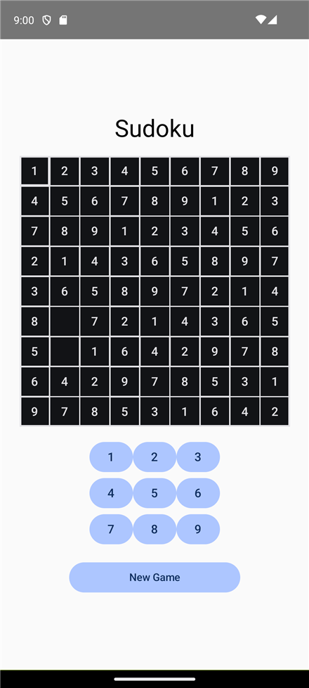

# AnimationPrac

<p>

</p>

Jetpack Compose animation playground: crossfade, fade, levitation, four-way fly-out, snowfall, plus small games (Simon, Sudoku).

## Stack

Kotlin, Jetpack Compose.

## Run

Open the project in Android Studio and run the `app` configuration.

```bash
./gradlew :app:assembleDebug
```
